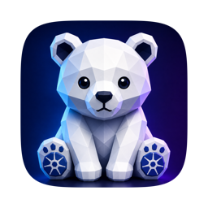
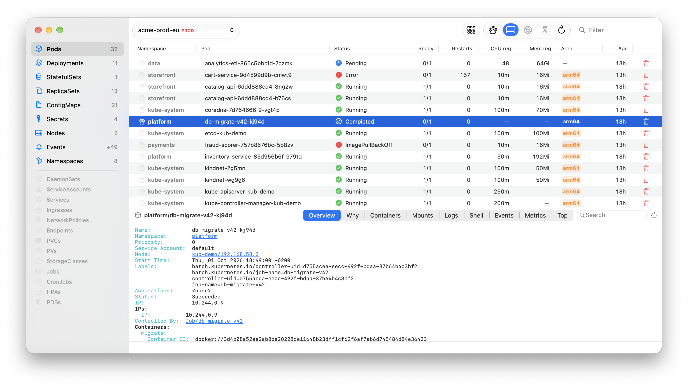
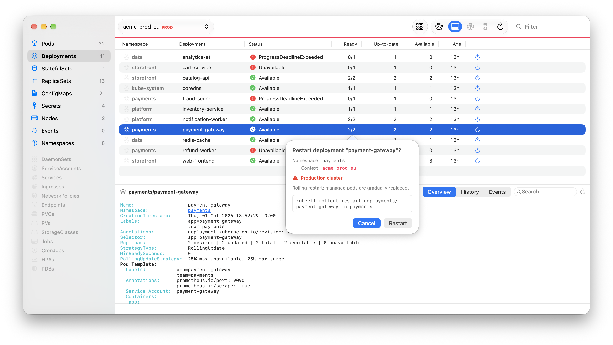

<p align="center">
  
</p>

<h1 align="center">Kub</h1>

<p align="center">
  <strong>The bear necessities of Kubernetes.</strong><br>
  A minimal, native macOS Kubernetes viewer for developers — browse every
  namespace, see why a pod is unhappy, follow its logs, and get back to code.
</p>

<p align="center">
  <strong>Free and open source</strong> · Native AppKit · No telemetry<br>
  No account · No subscription · Your kubeconfig, nothing else
</p>

<p align="center">
  <code>brew install --cask AlmazKo/tap/kub</code>
</p>



---

## Built for developers, not cluster operators

Most Kubernetes dashboards are made for running clusters. Kub is made for the
developer whose service runs *in* one: open it, pick a context, and see your
workloads across all namespaces in one table — then drill into a pod without
remembering a single `kubectl` flag.

Kub reuses your existing kubeconfig, including EKS exec authentication, and
talks to the cluster through the `kubectl` you already have.

## What Kub brings together

<table>
  <tr>
    <td width="50%" valign="top">
      <h3>~22 resource kinds, every namespace</h3>
      Pods, deployments, services, ingresses, config maps, secrets, events and
      more — sortable, groupable by namespace, status, node or workload, with
      type-to-search everywhere.
    </td>
    <td width="50%" valign="top">
      <h3>Know why a pod is unhappy</h3>
      The <em>Why</em> tab reads container states, restarts, OOM kills and
      conditions, and resolves the owning workload. Containers, mounts and a
      native Events table sit one click away.
    </td>
  </tr>
  <tr>
    <td width="50%" valign="top">
      <h3>Live logs and a shell</h3>
      Follow logs with filtering, timestamps and ANSI colours — follow pauses
      when you scroll up and resumes at the tail. Open an interactive shell in
      a container.
    </td>
    <td width="50%" valign="top">
      <h3>Port-forward and metrics</h3>
      Start port-forwards from a row and manage them from the toolbar. The
      <em>Metrics</em> tab scrapes a pod's Prometheus endpoint, discovered from
      ServiceMonitors, annotations or port names.
    </td>
  </tr>
  <tr>
    <td width="50%" valign="top">
      <h3>Everyday actions, safely</h3>
      Delete pods, restart, scale and roll back controllers. Every change goes
      through a confirmation that shows the exact command, and production
      contexts are flagged.
    </td>
    <td width="50%" valign="top">
      <h3>JVM diagnostics</h3>
      Take a heap dump or an
      <a href="https://github.com/async-profiler/async-profiler">async-profiler</a>
      flame graph of a Java process straight from the pod's process list, with
      progress in the toolbar and a notification when it is ready.
    </td>
  </tr>
</table>

## 🎨 Tell your clusters apart

Give each context its own colour and emoji. The colour runs as a band across the
content area and follows you into every confirmation, so a production cluster
never looks like your local minikube.

## 🔐 Read-mostly and production-safe

<p align="center">
  
</p>

> [!IMPORTANT]
> **Secret values are never shown.** Secrets and config maps display key counts
> only; nothing Kub renders on screen contains a secret value.

- **Every mutation confirms.** Delete, restart, scale, roll back and diagnostics
  open a confirmation with a live preview of the exact `kubectl` command. On a
  production context, Return defaults to *Cancel*.
- **No telemetry.** No analytics, tracking, account or remote service. Kub talks
  only to your clusters, through `kubectl`, with your credentials.
- **No leftovers.** Log streams, port-forwards and diagnostics are torn down
  when you switch away, close the window or quit — no orphaned `kubectl`
  processes holding ports.
- **Verified distribution.** Release builds and DMGs are Developer ID–signed,
  Apple-notarized and stapled.

## ⚡ Native and lightweight

Kub is a pure AppKit application: no Electron, no web views, no bundled
Kubernetes client. It follows the system appearance and uses Liquid Glass on
macOS 26.

---

## 📦 Install

Install with Homebrew:

```bash
brew install --cask AlmazKo/tap/kub
```

Or download the latest DMG from
[GitHub Releases](https://github.com/AlmazKo/Kub/releases) and drag Kub to
`/Applications`. The app and DMG are signed, notarized and stapled, so the first
launch works offline.

### Requirements

- macOS 14 Sonoma or newer. Apple Silicon and Intel Macs are supported.
- [`kubectl`](https://kubernetes.io/docs/tasks/tools/) and a kubeconfig in
  `~/.kube`. Exec-auth plugins (for example `aws` for EKS) are found in
  `/opt/homebrew/bin` and `/usr/local/bin`.

<details>
<summary><strong>Build from source</strong></summary>

<br>

```bash
git clone https://github.com/AlmazKo/Kub.git
cd Kub
open Kub.xcodeproj
```

Choose your own development team in Xcode under *Signing & Capabilities*, then
press **⌘R**. You can also build without signing by setting
`CODE_SIGNING_ALLOWED=NO`.

</details>

---

## Acknowledgements

Kub bundles [async-profiler](https://github.com/async-profiler/async-profiler)
(Apache License 2.0) and uses
[SwiftTerm](https://github.com/migueldeicaza/SwiftTerm) (MIT) for the shell.

## 💜 Free and open source

Kub is free to use, has no paid tier, and is released under the
[MIT License](LICENSE). Issues, ideas and contributions are welcome.
